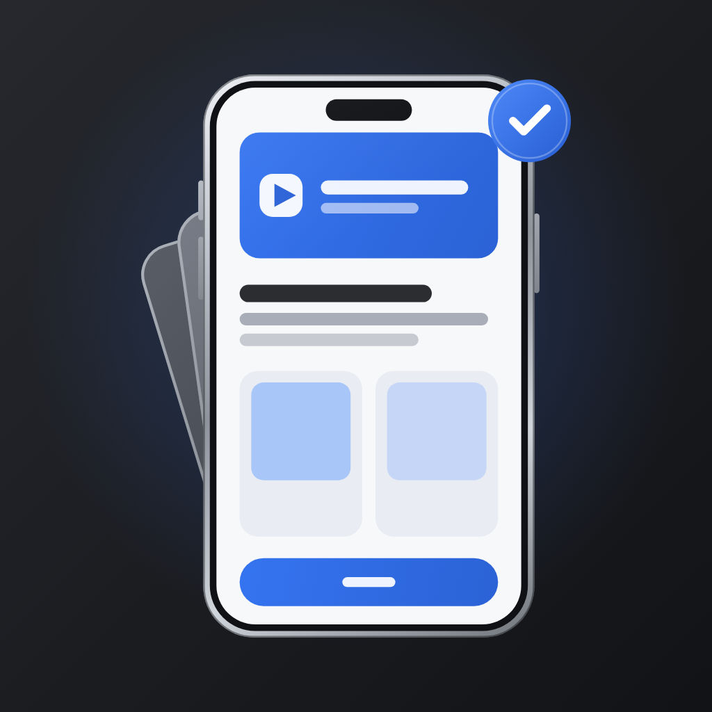

<p align="center">
  
</p>

<h1 align="center">MockMyApp</h1>

<p align="center">
  Design App Store and Google Play screenshots, icons and listing copy, on your own device.<br>
  Free and open source. No account, no server, no tracking.
</p>

---

**Source code:** [github.com/imamhossain94/mockmyapp](https://github.com/imamhossain94/mockmyapp)

MockMyApp is a store-screenshot designer built with Flutter. Put your app's screenshots into real
device frames, add backgrounds and captions, translate the set into the languages you ship in, and
export every size each store asks for. It runs in the browser and as a desktop app on macOS,
Windows and Linux, and builds for Android and iOS too.

Everything happens on your device. MockMyApp has no account to create, nothing to buy and no
server behind it, and it makes no network requests of its own: your projects, screenshots and
fonts never leave the machine you are working on.

## Features

**Device frames**
- Frames for current Android phones (Samsung, Google Pixel, OnePlus, Xiaomi, OPPO, vivo,
  Nothing, Sony, Motorola), drawn by the project's own generators from published dimensions, and
  drawn iPhones, plus tablets, laptops, monitors, browser windows and a foldable — searchable and
  filterable by maker and form factor.
- Several devices per screen, turned in true 3D with metal bands, side keys and lit shadows.
- Your own device: a frame built from a corner radius, bezel and cut-out.

**Design**
- Templates: complete multi-screen listings to start from, and their backdrops on their own,
  every part editable.
- Backgrounds: solid colours, gradients, more than 40 generated pattern styles and your own
  images; one continuous canvas across a whole set, so a background or a device can run from
  screen to screen.
- Captions with rich text, 17 bundled typefaces plus any TrueType or OpenType font you upload,
  and captions that shrink to fit.
- Layers: shapes, text, images, clip-art, Lucide icons and imported SVG shapes, with align guides,
  locking and reordering.
- A screenshot editor: crop and expand, a clean status bar, colour and light adjustments.
- Light and dark themes; Material You colour on Android.

**Export**
- Every store's exact sizes: App Store (iPhone, iPad, Mac, Apple Watch, Apple TV, Vision Pro,
  in-app events), Google Play (phone, tablet, Chromebook, Android XR, feature graphic), Microsoft
  Store, Galaxy Store, Huawei AppGallery and Chrome Web Store, plus Open Graph, X, LinkedIn and
  Product Hunt images, or any custom size.
- A store checker that catches the wrong size, format, file size or count before you upload, with
  one-tap fixes.
- PNG or JPEG, single screens or ZIPs, and a fastlane `deliver`/`supply` folder layout.
- Video: your devices in motion as MP4 (GIF where no encoder is available), with App Store app
  preview and Google Play promo presets.
- Store previews: see the set as it will look on the App Store, Google Play and five other stores.

**Listing**
- Store copy for every store — name, subtitle, keywords, descriptions, what's new, screenshot alt
  text — with live counters in each store's own units and checks for the things review rejects.
- 40 store languages: translate captions and store copy on the device.
- An icon studio: design the app icon once and export every file each store and platform needs,
  including iOS dark and tinted icons and Android adaptive and monochrome layers.

**On-device AI, with built-in rules everywhere**
- Caption ideas, a "Generate with AI" wizard that turns a description and your screenshots into a
  finished, editable set, background art direction, icon concepts and store copy drafts.
- They use the model your device already has — Apple Intelligence, Gemini Nano or Chrome's
  built-in AI — and Apple Translate, ML Kit or the browser's translator for translation. Where
  there is none, MockMyApp's built-in rules answer instead. Nothing is sent to a server.

**Your projects stay yours**
- Projects are saved on the device. Back up a project to a single ZIP and import it anywhere.

## Privacy: what goes online

MockMyApp itself makes no network requests: no account, no analytics, no crash reporting, and no
fonts or assets fetched at run time. **Your screenshots, images, fonts and projects are never
uploaded anywhere.** A few platform components it relies on do go online:

- **Translation on Android uses Google's ML Kit**, which downloads a language model the first time
  you translate into a language and may send usage metrics to Google (ML Kit also reads text off
  screenshots and runs Gemini Nano captions on Android). The words being translated are
  translated on the device.
- **Language packs and models managed by the operating system or the browser.** Apple Translate
  and Apple Intelligence on iOS and macOS, and Chrome's built-in translator and AI on the web, may
  download a language pack or model the first time you use them.
- **The web build's fallback fonts.** When text uses a script none of the bundled fonts cover —
  Chinese, Japanese, Korean, Arabic, Devanagari, emoji — Flutter's web engine fetches a Noto font
  for it from `fonts.gstatic.com`. To host those yourself, set `fontFallbackBaseUrl` in
  [`web/flutter_bootstrap.js`](web/flutter_bootstrap.js).

On macOS the app sandbox has no outgoing network access at all.

## Build and run

You need [Flutter](https://docs.flutter.dev/get-started/install) on the stable channel; CI uses
**Flutter 3.44.6**. No keys, secrets or `--dart-define` values are needed for any build.

```bash
git clone https://github.com/imamhossain94/mockmyapp.git
cd mockmyapp
flutter pub get
```

| Platform | Run while developing | Release build | Output |
|---|---|---|---|
| Web | `flutter run -d chrome` | `flutter build web --release` | `build/web/` |
| macOS | `flutter run -d macos` | `flutter build macos --release` | `build/macos/Build/Products/Release/MockMyApp.app` |
| Windows | `flutter run -d windows` | `flutter build windows --release` | `build/windows/x64/runner/Release/` |
| Linux | `flutter run -d linux` | `flutter build linux --release` | `build/linux/x64/release/bundle/` |
| Android | `flutter run -d <device>` | `flutter build apk --release` | `build/app/outputs/flutter-apk/app-release.apk` |
| iOS | `flutter run -d <device>` | `flutter build ios --release --no-codesign` | sign and archive in Xcode from `ios/Runner.xcworkspace` |

Platform notes:

- **Web.** `build/web/` is a static site: serve it from any static host or locally with
  `python3 -m http.server 8080 --directory build/web`. To serve it from a sub-path, such as a
  GitHub Pages project site, build with `--base-href /<path>/`. It loads everything, CanvasKit
  included, from its own folder.
- **macOS and iOS** need Xcode. Plugins build through Swift Package Manager; there is no
  CocoaPods step. A release build for distribution needs your own Apple signing (see
  [`docs/platform-setup.md`](docs/platform-setup.md)).
- **Windows** needs Visual Studio with the "Desktop development with C++" workload.
- **Linux** needs Flutter's Linux toolchain (`clang cmake ninja-build pkg-config libgtk-3-dev` on
  Debian and Ubuntu). MP4 export uses an installed `ffmpeg` or GStreamer, and falls back to GIF
  without one.
- **Android** builds are signed with the debug key unless you add `android/key.properties` (copy
  [`android/key.properties.example`](android/key.properties.example)). The minimum is Android 8
  (API 26).

## Tests

```bash
flutter analyze
dart format --output=none --set-exit-if-changed lib test tool integration_test
flutter test                                  # unit and widget tests
flutter test --platform chrome test/web       # the web-only storage and video tests
```

`integration_test/` drives the real app on a device or desktop window, for renders and visual
checks.

## Project structure

```
lib/
  app/            app shell: theme and design tokens, router, responsive layout
  data/           bundled catalogues (frames, templates, fonts, clip-art), on-disk
                  repositories (projects, images, fonts, backups) and platform services
                  (storage, video encoders, on-device AI bridges)
  domain/         models and the rendering engine: scenes, patterns, exports, the store
                  checker, store copy, listing analysis, icons, art direction
  features/       screens: home, new project, editor, store copy, icon studio, AI wizard,
                  settings, and the shared Studio* widget library
assets/           device frames, templates, clip-art, icons, bundled fonts, branding
android/ ios/ macos/ windows/ linux/ web/
                  platform runners; native code for storage, video encoding and on-device AI
test/             unit and widget tests;  test/web/ runs in Chrome
integration_test/ tests that drive the real app
tool/             generators for frames, templates, clip-art, branding and fonts (tool/README.md)
docs/             architecture, export, branding and platform notes, the journal, research
```

The project's website is a separate repository; nothing in the app needs it.

## Contributing

Contributions are welcome — bug reports, device frames, templates, translations and code.

1. Open an issue first for anything large, so the approach can be agreed before the work.
2. Fork, branch, and keep the change focused.
3. Before you push: `dart format`, `flutter analyze` (CI fails on infos too) and `flutter test`.
   New behaviour comes with a test next to the existing ones.
4. Keep MockMyApp on the device: no network requests, analytics, accounts or downloaded assets.
   A new font goes in with [`tool/bundle_google_fonts.py`](tool/bundle_google_fonts.py); generated
   files are rewritten by their generators, so change the generator (see
   [`tool/README.md`](tool/README.md)).
5. Exports must not depend on the theme, and saved projects must open unchanged in the next
   version — [`CLAUDE.md`](CLAUDE.md) lists these rules and the others that have mattered before.

[`ROADMAP.md`](ROADMAP.md) has what is planned, and [`docs/`](docs/) the architecture and
history. If you use Claude Code, `CLAUDE.md` and the skills in `.claude/skills/` apply to it.

## License

MockMyApp is released under the [MIT License](LICENSE).
Copyright (c) 2026 Md. Imam Hossain (New Age Devs).

Bundled fonts are under the SIL Open Font License (each licence sits beside its font in
`assets/google_fonts/`), and the Lucide icons under the ISC License (`assets/icons/LICENSE`). The
licences of every package the app uses are listed in the app, under Settings › Open Source
Licenses.
